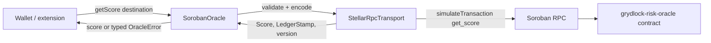

# grydlock-oracle-adapter

A TypeScript client that reads a 0–100 risk score for a Stellar address or asset from a Soroban
smart contract. Wallets and browser extensions use it to warn users before they sign.

[](https://github.com/Gryd-lock/grydlock-oracle-adapter/actions/workflows/ci.yml)
[](https://github.com/Gryd-lock/grydlock-oracle-adapter/releases)
[](LICENSE)

## Why it matters

Stellar payments are final within seconds and can't be reversed. Scammers rely on that. They
use lookalike `G…` addresses, muxed `M…` addresses that hide the account behind them, and
assets with familiar codes, since anyone can issue an asset called `USDC`. A wallet only shows
the user a 56-character string. Gryd Lock puts a risk score in front of the user at signing
time, and this adapter is the piece that fetches that score: it validates the destination, reads
the score on-chain with a free, read-only Soroban simulation, and fails closed. When it can't
get a trustworthy score, it returns a typed error instead of a misleading "0".

## Status

|     | Piece                           | Notes                                                                                                                                                                                                                               |
| --- | ------------------------------- | ----------------------------------------------------------------------------------------------------------------------------------------------------------------------------------------------------------------------------------- |
| ✅  | Live testnet reads              | `SorobanOracle` + `StellarRpcTransport` call `get_score` through Soroban RPC. Checked nightly against the deployed contract.                                                                                                        |
| ✅  | Reference contract on testnet   | [`contract/`](contract/): Rust, soroban-sdk 29, 13 unit tests. Deployed as `CA42XDMAPI3QXA4XP6HEBPWD3IHZQ3YJB4MABSURASGGOVYU5QCWSC2M`.                                                                                              |
| 🟡  | The scores themselves           | **Hardcoded test data.** One admin copied the 12 entries from grydlock-testkit's `scores.json` into the contract. There is no scoring engine.                                                                                       |
| ✅  | Destination validation          | G / M / C / L addresses and SEP-11 assets, using a from-scratch strkey codec.                                                                                                                                                       |
| ✅  | Cache, timeout, circuit breaker | Used by grydlock-extension.                                                                                                                                                                                                         |
| 🟡  | `StubOracle`                    | Offline, fixture-backed, development only. Returns `0` for destinations missing from the fixtures.                                                                                                                                  |
| 🟡  | Extension integration           | grydlock-extension imports v1.3.0 of this package with its own RPC transport, which doesn't match the deployed contract, so lookups report "unavailable" ([#124](https://github.com/Gryd-lock/grydlock-oracle-adapter/issues/124)). |
| 🟡  | Experimental modules            | Fallback routing, aggregation, batching, provenance, `RiskDecision`: tested but unused ([#130](https://github.com/Gryd-lock/grydlock-oracle-adapter/issues/130)).                                                                   |
| 🟡  | CI health                       | Tests pass, but the `npm audit` gate fails on upstream advisories, the API docs aren't published (Pages is off), and the mutation job is broken. See [docs/development.md](docs/development.md#ci-workflows).                       |
| ⬜  | Mainnet                         | No mainnet contract, multi-signer admin, audit or RPC failover ([#123](https://github.com/Gryd-lock/grydlock-oracle-adapter/issues/123)).                                                                                           |
| ⬜  | Offline contract tests in CI    | Contract tests run against live testnet rather than a local sandbox ([#92](https://github.com/Gryd-lock/grydlock-oracle-adapter/issues/92)).                                                                                        |

## Quick start

You need Node.js 20+ and git. The whole sequence takes about 3 minutes, most of it `npm ci`.

```sh
git clone https://github.com/Gryd-lock/grydlock-oracle-adapter.git
cd grydlock-oracle-adapter
npm ci
npm run build
npm test                         # ~370 tests, no network
node examples/read-score.mjs     # one live read from testnet
```

Expected output of the last command (the ledger number is when the score was written):

```
score 92 (live), contract CA42XDMAPI3QXA4XP6HEBPWD3IHZQ3YJB4MABSURASGGOVYU5QCWSC2M, ledger 5635427
```

Try `node examples/read-score.mjs 'SCAM:GAJLLIIPHII6OCG4KQJIGPCHVN6DNCRBXHX6DEUTPE7MQ6OONAYBRLET'`
for an asset (97). An address the contract doesn't know prints `no score: UNRECOGNIZED_DESTINATION`.
The public testnet RPC sometimes takes several seconds to answer.

Using it as a library:

```ts
import { createSorobanOracle, GRYDLOCK_TESTNET, OracleError } from 'grydlock-oracle-adapter';

const oracle = createSorobanOracle({
  ...GRYDLOCK_TESTNET,
  environment: 'development',
  requestBudgetMs: 20_000,
});

try {
  const result = await oracle.getScoreDetailed(destination); // { score, cacheStatus, ledgerSequence, ... }
} catch (error) {
  if (error instanceof OracleError) console.log(error.code); // e.g. UNRECOGNIZED_DESTINATION
}
```

The package is not published to npm. Install it from a git commit or tag. To run the live
test suite yourself, use `npm run test:live`.

## How it works



1. The destination is validated before any network call.
2. The transport simulates the contract's read-only `get_score` call. Nothing is signed or paid
   for.
3. `SorobanOracle` re-checks the response: schema, interface version, network, contract id, and
   ledger finality.
4. It returns a score, or a typed error such as `UnrecognizedDestinationError` or
   `WrongNetworkError`. A failure never becomes a number.

More detail:

- [docs/architecture.md](docs/architecture.md): request path, validation, fixtures, middleware,
  stable vs experimental API, bundle size.
- [docs/adr/0001-soroban-oracle-protocol.md](docs/adr/0001-soroban-oracle-protocol.md): the
  wire protocol and finality policy.
- [docs/errors.md](docs/errors.md): every error code.
- [contract/README.md](contract/README.md): the contract interface, events, and how to deploy it.

## How it fits in the project

| Repo                                                                  | Relationship (as implemented in code today)                                                                                                                                                                                                                            |
| --------------------------------------------------------------------- | ---------------------------------------------------------------------------------------------------------------------------------------------------------------------------------------------------------------------------------------------------------------------- |
| [grydlock-extension](https://github.com/Gryd-lock/grydlock-extension) | **Uses this package.** It installs a pinned commit (currently v1.3.0) and builds it on postinstall. It imports `SorobanOracle`, `StubOracle`, `CircuitBreakerOracle`, `withCache`, `withTimeout` and the error types. Its score source is off by default.              |
| [grydlock-testkit](https://github.com/Gryd-lock/grydlock-testkit)     | **Data source.** Its `scores.json` and `destinations.json` are vendored in `src/fixtures/testkit/` for `StubOracle` (refreshed weekly), and its `scores.json` seeded the testnet contract. The testkit's CI runs a consumer test against a pinned commit of this repo. |
| [grydlock-research](https://github.com/Gryd-lock/grydlock-research)   | **Defines the warning tiers.** There is no code dependency. `npm run sync:check` checks that the table below matches it.                                                                                                                                               |

The extension maps scores to tiers:

| Score  | Tier     | Behaviour                       |
| ------ | -------- | ------------------------------- |
| 0–20   | Low      | Proceed                         |
| 21–50  | Elevated | Soft warning                    |
| 51–75  | High     | Strong warning, require confirm |
| 76–100 | Critical | Recommend abort                 |

## Project structure

```
src/                     TypeScript client (public API in src/index.ts)
  SorobanOracle.ts       finality-aware oracle: validation, trust checks, error mapping
  StellarRpcTransport.ts live Soroban RPC transport (@stellar/stellar-sdk)
  createSorobanOracle.ts factory + GRYDLOCK_TESTNET target
  StubOracle.ts          offline fixture-backed oracle for development
  middleware/            withCache, withTimeout, withProvenance
  fixtures/testkit/      vendored grydlock-testkit fixtures and their parser
  fixtures/soroban/      protocol descriptor and response schema
contract/                Rust Soroban contract, unit tests, testnet deployment record
examples/                runnable examples (read-score.mjs)
tests/                   unit, fuzz, concurrency, type and live-testnet tests
scripts/                 build, bundle-size, smoke, fixture sync, deploy, cross-repo sync
docs/                    architecture, errors, development, ADRs
.github/workflows/       CI, contract, nightly testnet, release, sync jobs
```

## Roadmap

In priority order:

- [ ] Move grydlock-extension onto `StellarRpcTransport` and the deployed contract ([#124](https://github.com/Gryd-lock/grydlock-oracle-adapter/issues/124))
- [ ] Get every CI gate green again: dependency audit, API docs publishing, mutation testing ([#94](https://github.com/Gryd-lock/grydlock-oracle-adapter/issues/94))
- [ ] Move the testnet admin key into CI-managed custody and add a re-seed workflow ([#128](https://github.com/Gryd-lock/grydlock-oracle-adapter/issues/128))
- [ ] Multi-signer admin for score writes ([#120](https://github.com/Gryd-lock/grydlock-oracle-adapter/issues/120))
- [ ] RPC failover and real request cancellation ([#125](https://github.com/Gryd-lock/grydlock-oracle-adapter/issues/125), [#126](https://github.com/Gryd-lock/grydlock-oracle-adapter/issues/126))
- [ ] Batch reads and score provenance events ([#122](https://github.com/Gryd-lock/grydlock-oracle-adapter/issues/122), [#121](https://github.com/Gryd-lock/grydlock-oracle-adapter/issues/121))
- [ ] Offline Soroban sandbox for contract tests in CI ([#92](https://github.com/Gryd-lock/grydlock-oracle-adapter/issues/92))
- [ ] Mainnet readiness review ([#123](https://github.com/Gryd-lock/grydlock-oracle-adapter/issues/123))

## Contributing

1. Pick an [open issue](https://github.com/Gryd-lock/grydlock-oracle-adapter/issues). Each has a
   `difficulty:` label and acceptance criteria, and `good first issue` marks good starting points.
   Comment on it before you start.
2. Run the checks locally:
   `npm run typecheck && npm run lint && npm test && npm run size && npm run build`.
3. Open a PR with [Conventional Commits](https://www.conventionalcommits.org/) messages, which
   drive releases, and link the issue.

The full guide, including contract work and supply-chain rules, is in
[CONTRIBUTING.md](CONTRIBUTING.md). Development commands and CI are covered in
[docs/development.md](docs/development.md).

## License

[MIT](LICENSE)
